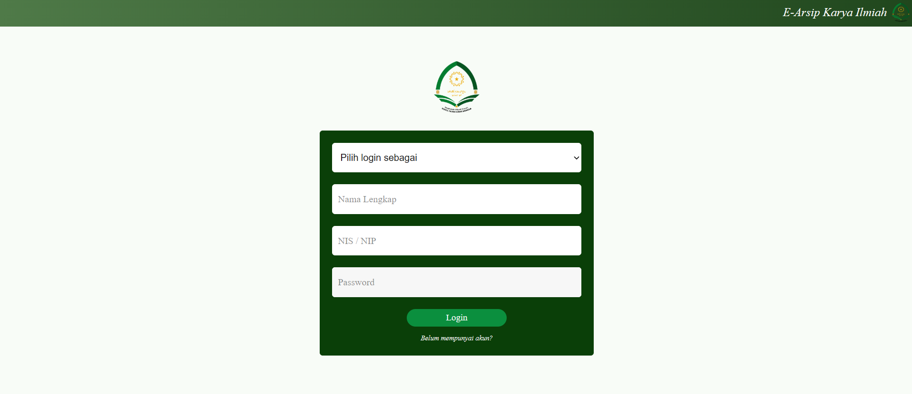
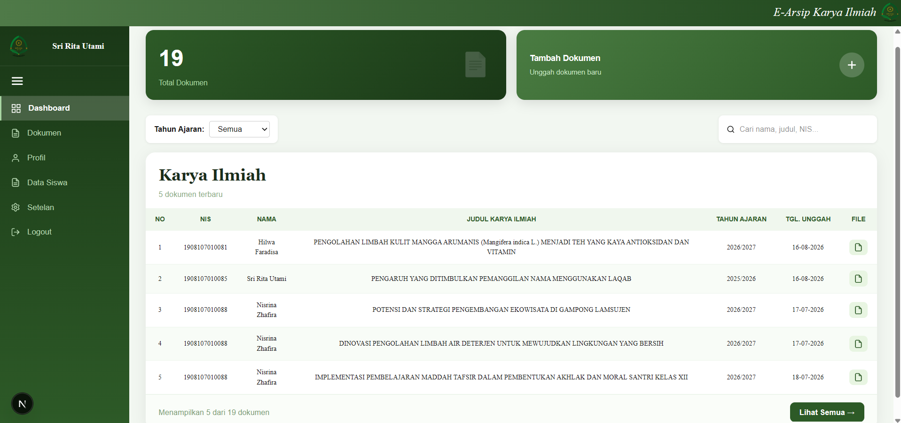
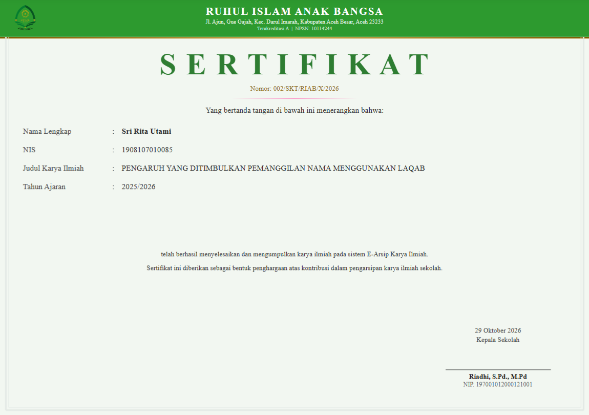

<div align="center">

# 📚 E-Arsip Karya Ilmiah
# Author: Sri Rita Utami

**Website Pengarsipan Karya Ilmiah Berbasis Next.js dan Google Drive**
Studi kasus: MA Ruhul Islam Anak Bangsa, Banda Aceh


</div>

---

## 📖 Daftar Isi

- [Tentang Proyek](#-tentang-proyek)
- [Informasi Skripsi](#-informasi-skripsi)
- [Fitur Utama](#-fitur-utama)
- [Teknologi](#-teknologi)
- [Arsitektur Sistem](#-arsitektur-sistem)
- [Struktur Database](#-struktur-database)
- [Instalasi](#-instalasi)
- [Hak Akses Pengguna](#-hak-akses-pengguna)
- [Pengujian](#-pengujian)
- [Tangkapan Layar](#-tangkapan-layar)
- [Lisensi](#-lisensi)
- [Kontak](#-kontak)

---

## 🎯 Tentang Proyek

**E-Arsip Karya Ilmiah** adalah aplikasi web untuk mengarsipkan karya ilmiah siswa secara digital, terpusat, dan terstruktur di MA Ruhul Islam Anak Bangsa.

Tujuan sistem:
- Menyimpan karya ilmiah siswa dalam satu platform.
- Memudahkan pencarian, pengunduhan, dan pengelolaan dokumen.
- Menerbitkan sertifikat dan bukti unggah otomatis dalam format PDF.

---

## 🎓 Informasi Skripsi

| Keterangan | Detail |
|---|---|
| **Judul** | Rancang Bangun Website Pengarsipan Karya Ilmiah Menggunakan Framework Next.js Berbasis Google Drive |
| **Penulis** | Sri Rita Utami |
| **Program Studi** | Informatika (Rekayasa Perangkat Lunak) |
| **Fakultas** | MIPA |
| **Universitas** | Universitas Syiah Kuala |
| **Dosen Pembimbing I** | Rasudin, S.Si, M.Info. Tech |
| **Dosen Pembimbing II** | Rini Deviani, ST., M.Eng |
| **Tahun** | 2026 |

---

## ✨ Fitur Utama

**🔐 Autentikasi**
- Login dengan JWT dan password terenkripsi (bcryptjs).
- Dua peran: Admin dan Siswa.

**📄 Manajemen Karya Ilmiah**
- Unggah karya ilmiah, file tersimpan di Google Drive.
- Pencarian dan pengunduhan dokumen.

**🏅 Sertifikat dan Bukti Unggah (PDF)**
- Dibuat otomatis dengan Puppeteer.
- Nomor sertifikat dibuat sekali dan tersimpan permanen, tidak berubah saat diunduh ulang.

**⚙️ Pengaturan oleh Admin**
- Format nomor sertifikat bisa diubah dengan placeholder `{nomor}`, `{bulan}`, `{tahun}`.
- Atur logo sekolah, warna header, serta nama dan NIP kepala sekolah.
- Aktifkan atau nonaktifkan fitur untuk siswa lewat tabel `settings`:

| Pengaturan | Fungsi |
|---|---|
| `allow_upload` | Izinkan atau larang unggah dokumen |
| `allow_download` | Izinkan atau larang unduh dokumen |
| `allow_print` | Izinkan atau larang cetak dokumen |

---

## 🛠 Teknologi

| Kategori | Teknologi |
|---|---|
| Framework | Next.js 14 (App Router) |
| Basis Data | MySQL |
| Penyimpanan File | Google Drive API v3 |
| Autentikasi | JWT + bcryptjs |
| Pembuat PDF | Puppeteer |
| Metodologi | Waterfall |

---

## 🏗 Arsitektur Sistem

```
┌──────────────────────────────┐
│  Browser (React / Next.js)   │
└──────────────┬───────────────┘
               │ HTTP
┌──────────────▼───────────────┐
│  Next.js Server              │
│  API Routes + Auth JWT       │
└───────┬──────────────┬───────┘
        │              │
┌───────▼──────┐ ┌─────▼────────┐
│   MySQL      │ │ Google Drive │
│   Data       │ │ File karya   │
└──────────────┘ └──────────────┘
```

---

## 🗄 Struktur Database

Empat tabel: `admin`, `siswa`, `karya_ilmiah`, `settings`.

Relasi: `karya_ilmiah.nis` → `siswa.nis` (`ON DELETE SET NULL`).

---

## ⚙ Instalasi

**Prasyarat:** Node.js 18+, MySQL 8+, Git, dan proyek Google Cloud dengan Drive API aktif.

```bash
# 1. Clone
git clone https://github.com/SriRitaUtami/E-Arsip_Karya_Ilmiah.git
cd E-Arsip_Karya_Ilmiah

# 2. Install dependency
npm install

# 3. Buat database lalu impor skema
mysql -u root -p -e "CREATE DATABASE nama_database CHARACTER SET utf8mb4;"
mysql -u root -p nama_database < database/schema.sql

# 4. Siapkan environment
cp .env.example .env.local

# 5. Jalankan
npm run dev
```

Buka http://localhost:3000

### Environment Variables

```env
DB_HOST=localhost
DB_USER=root
DB_PASSWORD=
DB_NAME=

JWT_SECRET=

GOOGLE_CLIENT_ID=
GOOGLE_CLIENT_SECRET=
GOOGLE_REDIRECT_URI=
GOOGLE_REFRESH_TOKEN=
GOOGLE_FOLDER_ID=
NEXT_PUBLIC_API_URL=
```

### Setup Google Drive API

1. Buat proyek di [Google Cloud Console](https://console.cloud.google.com/).
2. Aktifkan **Google Drive API**.
3. Buat **OAuth 2.0 Client ID** dan daftarkan redirect URI.
4. Ambil refresh token, lalu isi di `.env.local`.
5. Buat folder di Google Drive, salin ID-nya ke `GOOGLE_DRIVE_FOLDER_ID`.

---

## 👥 Hak Akses Pengguna

| Fitur | Admin | Siswa |
|---|:---:|:---:|
| Login dan logout | ✅ | ✅ |
| Lihat daftar karya ilmiah | ✅ | ✅ |
| Unggah karya ilmiah | ✅ | ✅ *(sesuai `allow_upload`)* |
| Unduh dokumen | ✅ | ✅ *(sesuai `allow_download`)* |
| Cetak dokumen | ✅ | ✅ *(sesuai `allow_print`)* |
| Unduh bukti unggah dan sertifikat | ✅ | ✅ |
| Kelola data siswa | ✅ | ❌ |
| Kelola seluruh karya ilmiah | ✅ | ❌ |
| Atur format sertifikat dan identitas sekolah | ✅ | ❌ |

---

## 🧪 Pengujian

| Metode | Hasil |
|---|---|
| Black-Box Testing | 25 skenario, 100% valid |
| PSSUQ | Skor 1,30 dari 7 (kategori sangat baik) |

---

## 🖼 Tangkapan Layar

| Login | Dashboard Admin |
|:---:|:---:|
|  |  |

| Dashboard Siswa | Sertifikat |
|:---:|:---:|
|  |  |

---

## 📄 Lisensi

MIT. Lihat berkas [`LICENSE`](LICENSE).

---

## 📬 Kontak

**Sri Rita Utami (Tata)**
- 📧 Email: _[sririta0411@gmail.com](mailto:sririta0411@gmail.com)_
- 🐙 GitHub: [@SriRitaUtami](https://github.com/SriRitaUtami)

---

## 🙏 Ucapan Terima Kasih

- Dosen pembimbing atas arahan dan bimbingannya.
- MA Ruhul Islam Anak Bangsa atas dukungan dan kesempatan penelitian.
- Seluruh responden yang berpartisipasi dalam pengujian.
